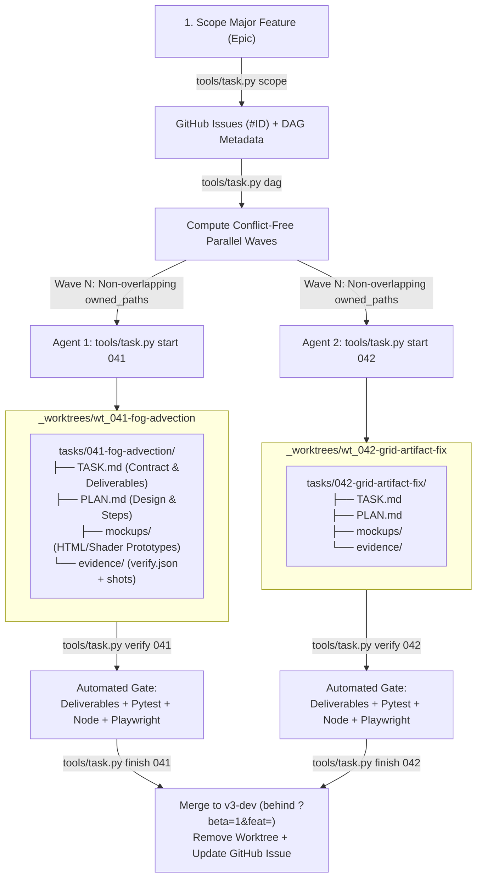

# Self-Contained Parallel Agentic Workflow Plan (`AGENTIC_WORKFLOW_PLAN.md`)

Purpose: End-to-end architecture for scoping major features into DAG-ordered tasks, executing them in parallel worktrees with self-contained plans/mockups/evidence, and deploying to Beta without collisions.
Status: current (implemented 2026-11-18)
Last verified: 2026-11-18

---

## 1. Executive Summary & Goals

As `SF-DEATH-FOG-DETECTION` grows across 3D WebGL shaders (`site/v3/`), live meteorology (`microclimate/live/`), and GPU LBM wind solvers (`microclimate/wind.py`), ad-hoc feature branches and scattered planning docs create three bottlenecks:
1. **Context & Token Overhead:** Agents spend thousands of tokens reading docs to figure out what is next, which files to touch, and what "done" means.
2. **Parallel Collision Risk:** Two agents working simultaneously can collide on shared files (`site/v3/app.js`, `microclimate/live/config.py`), overwrite preview screenshots (`artifacts/preview/`), or break the shared `?beta=1` preview channel.
3. **Scattered Planning & Mockups:** Plans live in `docs/<topic>/`, mockups in `docs/mockups/`, and verification output in untracked temp folders, making it hard to audit a feature's lifecycle from scope to ship.

### The Solution: A Three-Pillar Agentic System
1. **Self-Contained Task Packets (`tasks/<id>-<slug>/`) Inside Dedicated Worktrees (`_worktrees/wt_<id>-<slug>`)**: Every feature task owns one folder containing its `TASK.md` (contract & deliverables), `PLAN.md`, `mockups/`, and `evidence/` (automated test & screenshot proofs).
2. **GitHub Issues + Local DAG Task Tracker (`tools/task.py`)**: Major features are scoped as **Epics** and decomposed into atomic **Tasks** with explicit dependencies (`depends_on`), file ownership (`owned_paths`), and GPU locks (`gpu_required`). `tools/task.py dag` computes conflict-free parallel execution waves.
3. **Isolated Beta Feature Switches & Verification Gate (`?beta=1&feat=<slug>`)**: Features merge into `v3-dev` behind per-feature beta switches so multiple in-flight features can coexist on Beta without colliding. A task cannot be marked resolved until `python tools/task.py verify <id>` passes all tests, hygiene checks, and deliverable assertions.

---

## 2. System Architecture



---

## 3. Self-Contained Worktree & Task Packet Layout

Whenever a feature or task requires a plan and branch, `python tools/task.py start <id>` creates an isolated git worktree at `_worktrees/wt_<id>-<slug>` on branch `feat/<id>-<slug>` (branched from `origin/v3-dev`) and scaffolds a self-contained task directory:

```text
_worktrees/wt_042-grid-artifact-fix/
└── tasks/
    └── 042-grid-artifact-fix/
        ├── TASK.md          # Machine-validated YAML frontmatter + problem, scope, and acceptance criteria
        ├── PLAN.md          # Step-by-step technical plan and file/line targets (from tools/codemap.py)
        ├── mockups/         # Self-contained HTML/CSS/GLSL mockups or interactive widgets for this task
        └── evidence/        # Populated by `tools/task.py verify`:
            ├── verify.json          # Machine-signed pass/fail record (pytest, node, preview, deliverables)
            ├── preview_desktop.png  # Headless Edge desktop verification screenshot
            └── preview_phone.png    # Headless Edge mobile (390x844) verification screenshot
```

### 3.1 `TASK.md` Schema (Eliminating Guesswork & Reducing Tokens)
Every `TASK.md` begins with strict YAML frontmatter that acts as both the agent's prompt contract and the verifier's checklist:

```yaml
---
id: "042"
slug: "grid-artifact-fix"
title: "Clamp descending ray column-top skipping in fog2.js"
issue: 42
epic: 40
status: "in-progress"           # backlog | ready | in-progress | review | beta | done
branch: "feat/042-grid-artifact-fix"
switch: "col_top_clamp"         # viewer query flag (?feat=col_top_clamp) or config.BETA key
depends_on: []                  # task IDs that must reach 'beta' or 'done' first
owned_paths:                    # files/folders this task is allowed to modify
  - "site/v3/fog2.js"
  - "tests_js/test_fog2.mjs"
gpu_required: false             # true serializes execution via data/library/runs/gpu.lock
deliverables:                   # required files before `tools/task.py verify` can pass
  - "tasks/042-grid-artifact-fix/PLAN.md"
  - "site/v3/fog2.js"
  - "tasks/042-grid-artifact-fix/evidence/verify.json"
  - "tasks/042-grid-artifact-fix/evidence/preview_desktop.png"
---
```

### 3.2 Zero-Copy Access to 10 GB `data/` and Live Viewer Assets in Worktrees
Today, git worktrees under `_worktrees/wt_*` do not contain gitignored folders (`data/`, `site/v3/live/`, `site/v3/live_beta/`). We solve this automatically so every worktree runs tests and previews immediately with zero manual setup:
1. **Worktree-Aware `microclimate/paths.py`**: Update `data_dir()` to detect when `REPO_ROOT` is inside `_worktrees/wt_*` (by checking `(REPO_ROOT.parent.parent / "data").exists()`) and automatically resolve to the main checkout's `data/` directory.
2. **Live Data Junctions for Local Previews**: When `tools/task.py start` creates a worktree, it links `site/v3/live` and `site/v3/live_beta` (via Windows directory junctions `mklink /J` or fallback static path resolution in `tools/preview.py`) to the main repo's live folders so `tools/preview.py --serve` and `--check` work inside any worktree instantaneously.

---

## 4. Preventing Collisions Across Parallel Features & Beta Deploys

### 4.1 Path-Ownership & GPU Scheduling Guardrails
Two agents working in parallel collide only if they edit the same file sections or contend for the single local GPU. `tools/task.py` prevents both:
- **`owned_paths` Intersection Check**: When computing parallel waves (`tools/task.py dag`) or starting a task (`tools/task.py start <id>`), the CLI compares `owned_paths` against all currently active `status: in-progress` tasks. If an overlap exists (e.g., two tasks both claim `site/v3/app.js`), `tools/task.py` flags the conflict and places the second task in the next wave (or requires section-level partitioning).
- **Enforced Scope Check on Verify**: `tools/task.py verify <id>` runs `git diff --name-only origin/v3-dev...HEAD` and verifies that every modified file outside `tasks/<id>-<slug>/` matches `owned_paths`. If an agent accidentally edits an out-of-scope file, verification fails until reverted or explicitly added to `owned_paths`.
- **Single-GPU Mutual Exclusion**: Any task with `gpu_required: true` checks `data/library/runs/gpu.lock` and cannot run in parallel with another GPU task.

### 4.2 Non-Colliding Beta Feature Switches (`?beta=1&feat=<slug>`)
To allow multiple features to be merged into `v3-dev` and deployed to Beta without breaking one another:
1. **Viewer Feature Gate Helper (`site/v3/`)**:
   - Standardize a 5-line helper in `site/v3/`:
     - `featOn(slug, defaultInBeta = true)`: reads URL query `?feat=<slug>` (or `?feat=-<slug>` to disable a specific feature on `?beta=1`).
     - In-flight or experimental UI/shader features start with `defaultInBeta = false` (activated via `?beta=1&feat=<slug>`), so two features merged to `v3-dev` can be tested independently on the live GitHub Pages site (`https://george-the-g.github.io/SF-DEATH-FOG-DETECTION/v3/?beta=1&feat=col_top_clamp` vs. `?beta=1&feat=guide14_advect`) before being turned on by default in `?beta=1`.
2. **Backend Pipeline Switch Isolation (`microclimate/live/config.py`)**:
   - Every new physics or data layer continues to register a named key in `config.BETA` (defaulting to `False` in `PROMOTED`).
   - Add `--enable-switch <k>` / `--disable-switch <k>` CLI overrides to `python -m microclimate.live build --beta` so local verification and A/B comparisons can test a single feature switch in isolation without altering other beta switches.
3. **Mockup Self-Containment**:
   - Interactive UI mockups live in `tasks/<id>-<slug>/mockups/` and can be previewed via `python tools/preview.py --serve --root tasks/<id>-<slug>/mockups` (or relative imports to `/site/v3/`), keeping `site/v3/` clean until the mockup is approved.

---

## 5. GitHub Task Tracker & DAG Orchestration (`tools/task.py`)

We tie the repo directly to **GitHub Issues** via the `gh` CLI while mirroring active task specs in `tasks/<id>-<slug>/TASK.md` and a gitignored local cache (`data/tasks_index.json`).

### 5.1 Why Hybrid GitHub Issues + Local `TASK.md`?
| Capability | GitHub Issues (`gh issue`) | Local `tasks/<id>-<slug>/TASK.md` |
|---|---|---|
| **Mobile / Browser Scoping** | Add or reprioritize features from GitHub UI or phone | Synced automatically via `tools/task.py sync` |
| **Zero-Token "What's Next?"** | Labels (`epic`, `task`, `status:ready`, `status:beta`) filterable in 1 API call | Offline/sandbox fallback via `data/tasks_index.json` |
| **Code Review & Audit Trail** | Issue comments log verification JSON & beta URLs | Travels with the branch and PR into `v3-dev` |

### 5.2 CLI Commands (`python tools/task.py <cmd>`)

1. **`python tools/task.py list` / `python tools/task.py dag`**
   - Parses all tasks and their `depends_on` + `owned_paths` + `gpu_required` fields.
   - Outputs a concise (~150-token) topological execution plan grouped into **Parallel Waves**:
     ```text
     WAVE 1 (Ready to run in parallel now — 0 path conflicts):
       [041] guide14-Window-taper   (owns: microclimate/live/travel.py)      [CPU]
       [042] fog2-col-top-clamp     (owns: site/v3/fog2.js)                  [CPU]
       [043] wetness-tracer-ref     (owns: microclimate/wetness.py)          [CPU]
     WAVE 2 (Blocked by Wave 1):
       [044] cloud-pipeline-e2e     (depends_on: 041, 042)
     ```
2. **`python tools/task.py new --title "..." --slug <slug> [--epic <n>] [--depends 041] [--owns path1,path2]`**
   - Creates a GitHub Issue with structured YAML frontmatter in the body, assigns the issue number as the Task ID, and scaffolds `tasks/<id>-<slug>/TASK.md` and `PLAN.md`.
3. **`python tools/task.py start <id>`**
   - Verifies dependencies in `depends_on` are satisfied and no active worktree owns overlapping `owned_paths`.
   - Creates branch `feat/<id>-<slug>` off `origin/v3-dev` and checks out `_worktrees/wt_<id>-<slug>`.
   - Links `site/v3/live` and `site/v3/live_beta` for instant previewing.
   - Outputs a **Token-Efficient Agent Brief** containing:
     - The task contract from `TASK.md`
     - Live line-number outlines for `owned_paths` generated on the fly via `tools/codemap.py`
     - The exact `tools/task.py verify <id>` command required to finish.
4. **`python tools/task.py verify <id>`**
   - Enforces the **Definition of Done** before an agent is allowed to resolve a task:
     1. **Deliverables check:** Every file listed in `deliverables` in `TASK.md` exists and is non-empty (including `PLAN.md`).
     2. **Scope check:** `git diff --name-only origin/v3-dev...HEAD` touches only `owned_paths` and `tasks/<id>-<slug>/`.
     3. **Python & Hygiene suite:** `python -m pytest` passes (verifying all `///` / docstring / `@sec:` rules from `test_repo_hygiene.py`).
     4. **JavaScript suite:** `node --test tests_js/*.mjs` passes.
     5. **Headless Playwright Check (if `site/v3/` touched):** Runs `tools/preview.py --check "?beta=1&feat=<slug>"` (desktop + `--phone`), saving screenshots directly to `tasks/<id>-<slug>/evidence/`.
     6. **Writes `tasks/<id>-<slug>/evidence/verify.json`** with timestamp, git SHA, test counts, and error count = 0.
5. **`python tools/task.py finish <id> [--merge] [--deploy-beta]`**
   - Asserts `verify.json` exists, matches current `HEAD` SHA, and has `"ok": true`.
   - Commits/pushes `feat/<id>-<slug>`.
   - When `--merge` is passed: merges into `v3-dev`, pushes `origin/v3-dev`, removes `_worktrees/wt_<id>-<slug>`, posts the verification summary to the GitHub Issue, and updates its label to `status:beta`.
   - When `--deploy-beta` is passed: triggers `gh workflow run collect.yml --ref main`.

---

## 6. Agent Skills & Orchestration Workflow

We package the agent instructions into generic, model-agnostic skills under `.agents/skills/` (`.agents/skills/deathfog-task-workflow/SKILL.md`, `.agents/skills/deathfog-agent-brief/SKILL.md`, and `.agents/skills/deathfog-ship/SKILL.md`) and link them from `AGENTS.md` (with no vendor-specific `.claude/skills/` folder):

### 6.1 Three Operating Modes for Agents
1. **Mode A — Feature Scoping (`Scope & Plan`)**:
   - Triggered when the user asks to plan a major new feature or backlog epic.
   - The lead agent inspects affected modules with `python tools/codemap.py`, drafts the architecture plan, and runs `python tools/task.py new ...` to decompose the epic into 2–6 atomic tasks with non-overlapping `owned_paths`, explicit `depends_on`, and concrete `deliverables`.
2. **Mode B — Single-Task Execution (`Start -> Plan/Mockup -> Code -> Verify -> Finish`)**:
   - Triggered for an individual task `<id>`.
   - Agent runs `python tools/task.py start <id>`, works strictly inside `_worktrees/wt_<id>-<slug>`, writes `PLAN.md` (and `mockups/` if UI-facing), implements the code within `owned_paths`, runs `python tools/task.py verify <id>`, and reports the `evidence/` outputs.
3. **Mode C — Parallel Wave Execution (`Swarm / Subagents per Wave`)**:
   - Triggered when the user says *"implement Wave 1 of Epic #40 in parallel"*.
   - The coordinator runs `python tools/task.py dag`, spawns one subagent per ready task in Wave 1 (each assigned to its own `_worktrees/wt_<id>-<slug>`), waits for each subagent to pass `python tools/task.py verify <id>`, and then sequentially merges verified branches into `v3-dev` and deploys once to Beta.

---

## 7. Implementation Roadmap (How We Will Build This Workflow)

Once you approve this plan, we can implement the entire workflow cleanly in 4 small steps:

1. **Step 1 — Worktree Data & Preview Auto-Resolution (`microclimate/paths.py` & `tools/preview.py`)**
   - Make `microclimate.paths.data_dir()` automatically detect `_worktrees/wt_*` and resolve to the parent repo's `data/` directory.
   - Update `tools/preview.py` to support worktree fallback for `/live/` and `/live_beta/` assets so headless Playwright checks work inside any worktree with zero copying.
2. **Step 2 — Task Lifecycle & DAG CLI (`tools/task.py`) + Hygiene Test Integration**
   - Build `tools/task.py` with subcommands: `new`, `sync`, `list`, `dag`, `start`, `verify`, `finish`.
   - Add `TASK.md` schema validation to `tests/test_repo_hygiene.py` so any folder under `tasks/` is automatically checked for valid frontmatter and non-empty deliverables.
3. **Step 3 — Viewer Per-Feature Beta Flag Helper (`site/v3/`)**
   - Add the lightweight `?feat=<slug>` query helper in `site/v3/app.js` and `--enable-switch` / `--disable-switch` in `microclimate/live/build.py` so parallel features can be tested in isolation on Beta.
4. **Step 4 — Generic Skills (`.agents/skills/`) & Initial Backlog Seeding**
   - Create `.agents/skills/deathfog-task-workflow/SKILL.md`, migrate `deathfog-agent-brief` and `deathfog-ship` into `.agents/skills/` (removing `.claude/skills/`), update `AGENTS.md`, and seed the current open backlog items from `docs/STATUS.md` (H2 5m Street Wind, H3 Tracer Saturation, Guide 14 Advection, and Voxel Grid Artifact Fix) as the initial DAG tasks so you can see `python tools/task.py dag` in action immediately.
